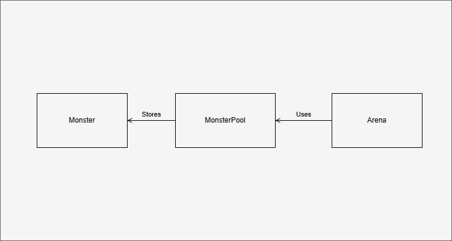
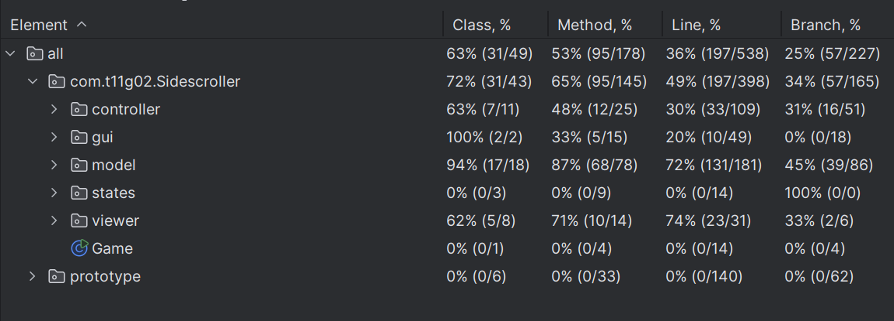

## LDTS_t11g02 - Jetpack Sidescroller
In this infinite sidescroller game, you play as Hero with a Jetpack and try to dodge the red laser beams and survive as long as possible. Use the arrow keys to move up and down, Enter on the menu to select an option and q to go to the menu. Be careful with your life value!

This project was developed by David Monteiro (up202306751@fc.up.pt), David Pinto (up202404233@fe.up.pt) and Luca Zielinsky (up202302132@fe.up.pt) for LDTS 2025-2026.

### IMPLEMENTED FEATURES
- **Flying and falling** - The game character will move up and down when the respective arrows are pressed.

- **Lasers** - Red lasers are generated randomly on the right edge of the screen and they move left at a constant speed.

- **Life Total** - When you character hits a laser beam, it will lose a life. You start with 10 and the game ends when you lose all your lives.

- **Score** - The score increases as you collect coins.

- **High Score** - The highest score achieved in all game sessions is stored and displayed on the main menu.

- **Extra Lives** - When you collect a star, you gain an extra life.

- **Menus** - You can navigate through the menu using the arrow keys and Enter. You can also go to the menu by pressing 'q'.

### PLANNED FEATURES

No more features are planned as the development of the game has been concluded.

### DESIGN

### The Creation of Lasers

**Problem in Context**

The amount of lasers (we call them Monsters in our code) could be a problem as instantiating too many lasers could slow down the game. We needed a way to avoid the excessive creation of new lasers.

**The Pattern**

We have applied the **Object Pool** pattern. This pattern allows us to store the objects we aren't currently using and get them when we do need them, thereby avoiding extra instantiations. This pattern allowed to address the problem because we could now store the lasers that hit the left border of the screen in a pool and reuse them when we were generating new lasers on the right border.

**Implementation**

The Arena uses the MonsterPool whenever it wants access to the lasers. The MonsterPool stores the lasers (called Monsters in out code) that have been created and knows whether they are being used or not. When a new laser is needed, the MonsterPool returns one of the unused ones (if any are available).

When we added Coins and Extra Lives (Stars) to the game, we also used the Object Pools to handle their creation and reuse.

  

<b><i>MonsterPool Class Diagram</i></b>

**Consequences**

- The MonsterPool handles the creation and reuse of lasers, reducing the amount of unnecessary instantiations.
- When we iterate over the Monsters in the MonsterPool to reuse the ones that have left the screen, we store those in a buffer and then clear it after the iteration so we won’t delete them while we are iterating over them.
- We could run into issues if we try to generate new lasers when there are none available. This hasn't been a problem so far, but it could become one if we decide to increase the size of the Arena and/or the amount of lasers generated.

### Score Keeping

**Problem in Context**

We needed a way to access the score from different parts of the code (e.g., the Arena to increase it when collecting coins and the Menu to display it). We also wanted to ensure that there was only one instance of the score throughout the game.

**The Pattern**

We have applied the **Singleton** pattern. This pattern allows us to ensure that a class has only one instance and provides a global point of access to it. This pattern allowed to address the problem because we could create a Score class that would be the only instance responsible for managing the score.

**Implementation**

The Score class is implemented as a Singleton. It has a private constructor and a static method to get the instance. The Arena and Menu classes access the Score instance to update and display the score.
The ScoreKeeper class is responsible for keeping reading and writing the high score to a file. It is also implemented as a Singleton to ensure that there is only one instance managing the high score.

**Consequences**

Testing the ScoreKeeper hasn't been done because we would need to alter the file that stores the high score, which could lead to inconsistencies.

### MVC
We used the MVC pattern, separating the model, the view and the controller for easier maintenance and development. This was made easier by our use of the Hero-Solid repository (available on Moodle) as a base for our project.

### Menus
Since we used the Hero-Solid repository (available on Moodle) as a base for our project, we also used the menu system made by professor André Restivo.

### Prototype
Inside the folder Prototype we kept a prototype of our game. It is fully functional and can be used as a base for future development.

### KNOWN CODE SMELLS

- More tests should be added (and some should be more complex).
- More comments should be added for better readability.

### TESTING

[Mutation Testing Report](../build/reports/pitest/index.html)

  

<b><i>Coverage Report</i></b>

### SELF-EVALUATION

Work was not divided fairly.

- David Monteiro: 70%
- David Pinto: 25%
- Luca Zielinsky: 5%